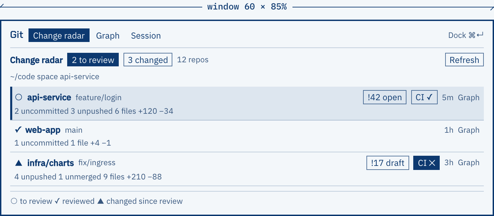
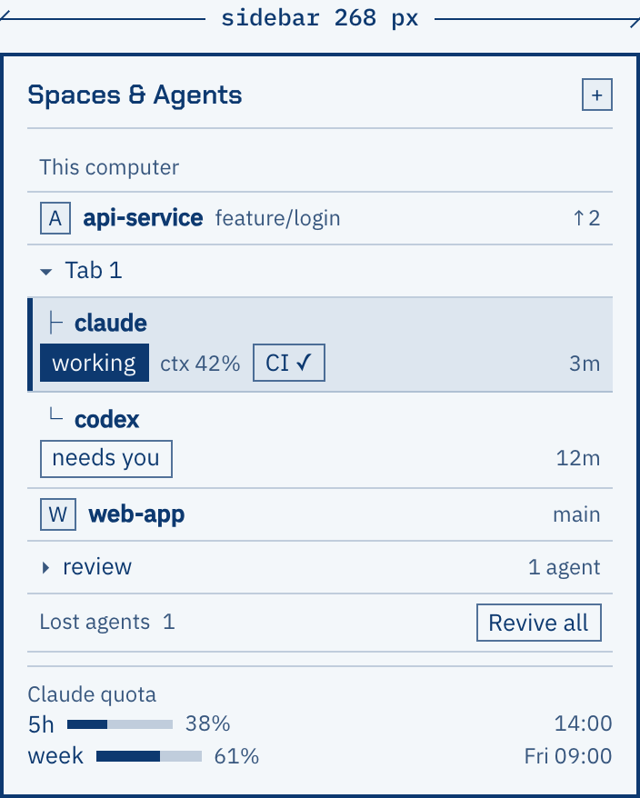
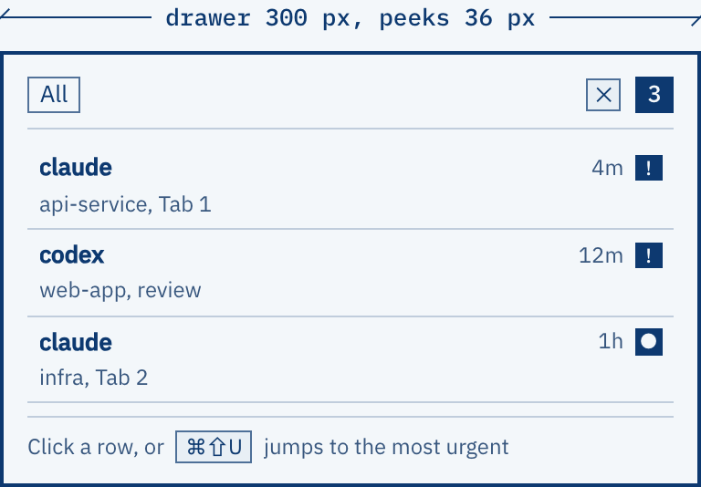
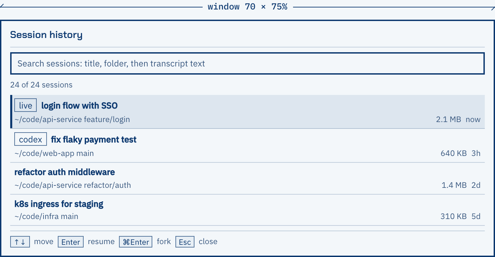
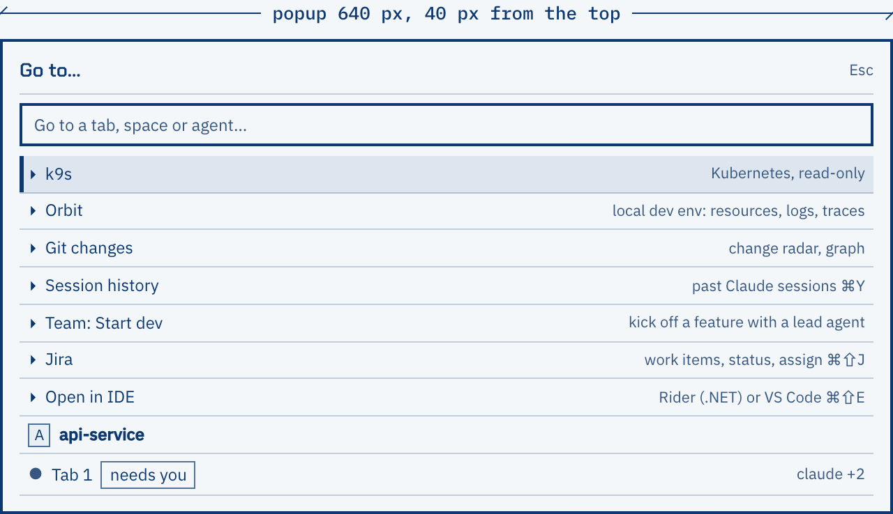
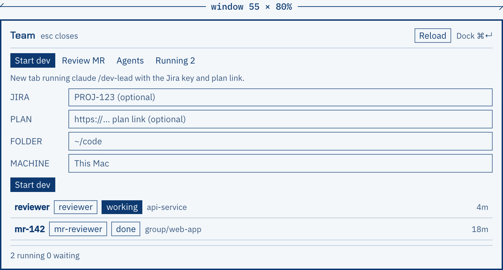
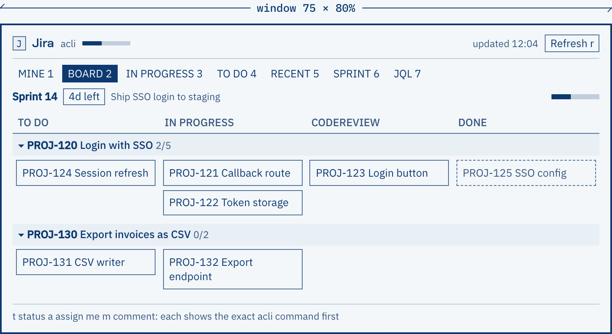
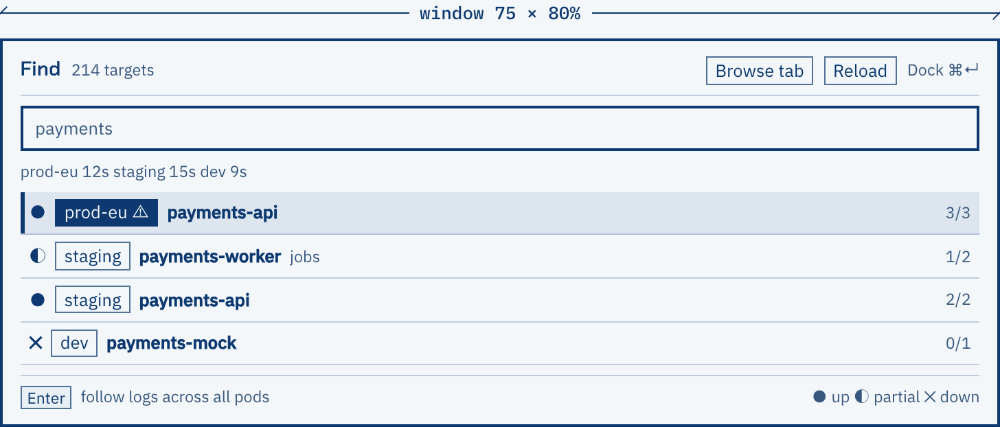
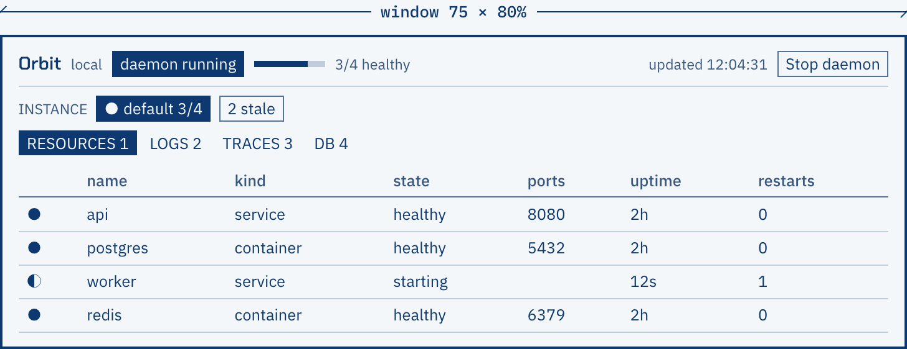
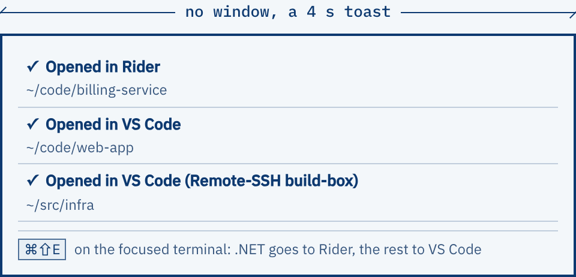

# herdr-mod

Ten mods and one layout for [Herdr](https://herdr.dev), the desktop app for terminals and coding agents. They put agent status, git, CI, Kubernetes and Jira inside the Herdr window.

**Site:** [herdr-mod.goenchang.dev](https://herdr-mod.goenchang.dev)



The pictures in this README are simplified screens, not screenshots: each one shows a mod's real labels, buttons and size from its `RECIPE.md`, filled with sample data. The site shows the same screens; pick a mod there to switch.

## Install

Herdr's agent installs mods for you. In a Herdr terminal, tell the agent:

```text
Read ~/.config/herdr-app/AGENTS.md, then add agent-radar from github.com/enchang1017/herdr-mod
```

Swap `agent-radar` for any folder name below. The agent then:

1. Reads the mod's `RECIPE.md` and files, and tells you what it runs, reads and reaches on the network.
2. Copies `mods/<name>/` into `~/.config/herdr-app/mods/`. If the name is taken, it renames the new one.
3. Merges the mod's `keys.json` into yours, and asks before it takes a key you already use.
4. Runs `herdr-app check` on the mod.

`spaces-agents` is a layout as well as a mod, so it also switches to the layout. `ctrl-shift-l` switches back.

## The mods

| No. | Mod | What it does | Opens with | Needs |
| --- | --- | --- | --- | --- |
| 01 | [`spaces-agents`](spaces-agents) | One sidebar for machines, spaces, tabs and agents, with lost sessions and Claude quota. | Layout; `⌘⌥T` reopens the last closed tab | `hc`, `claude` |
| 02 | [`agent-radar`](agent-radar) | A drawer that slides out when an agent is blocked or done, and a panel of every agent. | `⌘⇧A` panel, `⌘⇧U` jump | `hc` |
| 03 | [`change-radar`](change-radar) | Every repo with uncommitted, unpushed or unmerged work, its graph, MR and pipeline. | `mod.open:change-radar` | `git`, `python3`, `claude`, `hc`, `glab` |
| 04 | [`session-history`](session-history) | Search past Claude Code and Codex sessions; resume one in a new tab. | `⌘Y` | `python3`, `claude` or `codex`, `rg` optional |
| 05 | [`picker-plus`](picker-plus) | Herdr's Go to picker, with rows that open the other windows here. | `⌘P` | the other mods here, for its rows |
| 06 | [`team`](team) | Start and review agent teams from herdr-core templates, in a tab or a worktree. | `mod.open:team` | `hc`, `claude`, `glab` for MR review |
| 07 | [`jira`](jira) | Your work items and the sprint board; every write shows its `acli` command first. | `⌘⇧J` | `acli` |
| 08 | [`k9s`](k9s) | Find a deployment in any kube context and follow its logs across all pods. | `⌘⇧K` | `kubectl`, `hc`, `claude` |
| 09 | [`orbit`](orbit) | Resources, logs, traces and DB drift of a local orbit dev environment. | `⌘⇧O` | `orbit` CLI and daemon |
| 10 | [`open-ide`](open-ide) | Opens the focused folder in Rider for .NET, VS Code otherwise, Remote-SSH when remote. | `⌘⇧E` | `code`, Rider (macOS) |

Each folder has a `RECIPE.md`: a brief another agent can rebuild the mod from, with every size, key and behaviour. The table and notes below are a summary of those recipes.

### spaces-agents



One sidebar replaces Herdr's separate Spaces and Agents lists: each machine, its spaces, each space's tabs, and the agents in them with status, context use, CI state and age. Claude sessions whose tab was closed stay under "Lost agents" so you can revive them, a whole team at a time. It also turns JSON files dropped into the inbox folder into toasts, and folds teammate panes like an accordion.

The Claude quota block needs Claude Code's statusline to tee its input. [`spaces-agents/INSTALL.md`](spaces-agents/INSTALL.md) has the optional steps; they change `~/.claude/settings.json`, so back it up first.

### agent-radar



Hidden while nothing needs you. When an agent is blocked, or finished while you weren't looking, a 36 px tab peeks from the right edge with a count. Hover slides out the 300 px card: one row per agent with its program, name, age, space and tab. Click a row or press `⌘⇧U` to jump to the most urgent one. `⌘⇧A` opens a panel listing every agent by status.

### change-radar

A window with three tabs. **Change radar** lists every repo under the space's folder that has uncommitted, unpushed or unmerged work, with its merge request and pipeline; open one for its files, diffs, range compare and a short AI summary, then mark it reviewed or hand it to a reviewer agent. **Graph** draws one repo's history as lanes with its GitLab card. **Session** shows what one Claude session changed, repo by repo, and the pipelines and MR comments of what it pushed; a CI failure can go back to that agent with one click.

Settings live in `data/change-radar/settings.json` (`gitHost`, `reviewCommand`, repo name lists). AI text is asked for in Traditional Chinese; change the prompt lines in `summary.js`, `walk-run.js` and `ci-poll.js` for another language.

### session-history



A window, 70 by 75%, listing every past Claude Code and Codex session on this computer, newest first. Type to filter by title, folder or branch; after a pause it also searches transcript text and shows the matching line. Enter jumps to a session that is still running, or resumes it in a new tab.

### picker-plus



A 640 px popup, 40 px from the top: Herdr's Go to picker with the other windows of this repo on top. One `⌘P` jumps to a tab, space or agent, starts a new one, or opens k9s, Orbit, Git, Session history, Team, Jira or Open in IDE. Rows for mods you did not install still show; delete them from `MOD_ENTRIES`.

### team



A launcher in four tabs. **Start dev** opens a Claude tab running your own `dev-lead` skill on a Jira key and plan link. **Review MR** has a GitLab merge request reviewed into a markdown report. **Agents** starts any herdr-core template (`reviewer`, `mr-reviewer`, `refactorer`, `tester` ship in [`team/templates`](team/templates)) on a repo, in the team tab or a fresh worktree. **Running** lists live team agents. Every launch is a full Claude session on your quota.

### jira



Driven by the Atlassian CLI. Views: your open items, the active sprint as a board with one lane per story, in progress, to do, recent, the sprint as a list, or any JQL. An item opens in a drawer with its description, sub-tasks, links and comments. Moving, assigning or commenting first shows a confirm card with the exact `acli` command it will run. Set `project` in `data/jira/settings.json` for the board and sprint views.

### k9s



Type part of a deployment name to find it in any kube context, then Enter follows its logs across all pods. Browse pods, deployments, services, nodes, events and ingresses; a row opens a drawer with health, CPU and memory, events, YAML, logs and describe. Every context is read-only unless you list it in `data/k9s/settings.json`; on a listed context, delete, restart and scale ask first and go to an audit log.

### orbit



A k9s-style window onto a local orbit dev environment: whether its daemon runs, the instances, and tabs for resources, logs, traces and SQL Server DB drift. One key opens a service's URL, another hands logs, a trace or a drifted database to a Claude session. Built for one specific `orbit` CLI and its daemon's JSON; it is of no use without them.

### open-ide



No window, only a toast. `⌘⇧E` opens the focused terminal's folder in Rider when it (or its git root) holds a .NET solution, VS Code otherwise, and VS Code Remote-SSH when the terminal runs on another machine. macOS only.

## What each mod touches

Herdr's agent reports this before it installs a mod. In short:

| Mod | Runs | Network | Writes outside its folder |
| --- | --- | --- | --- |
| spaces-agents | `hc`, `claude` (revive resumes a full session), `git`, `ps` | none | deletes inbox files it showed |
| agent-radar | `hc` | none | none |
| change-radar | `git`, `glab`, `claude`, `python3`, `hc` | git remote on Fetch, GitLab read-only via `glab`, diffs to Anthropic for summaries | git refs on Fetch |
| session-history | `python3`, `rg`, `claude`, `codex` | none | none |
| picker-plus | `herdr-app` | none | none |
| team | `hc`, `claude` | none from the mod; agents use their own | a copied template on a remote machine |
| jira | `acli` | Jira, through `acli` only | Jira, after a confirm card |
| k9s | `kubectl`, `hc`, `claude` | `kubectl proxy` on 127.0.0.1, Grafana links | the cluster, only on listed contexts |
| orbit | `orbit` | localhost only | Restart and Stop act for real, behind a 6 s confirm |
| open-ide | `open`, `code` | none | none |

Several mods read `~/.claude/sessions/<pid>.json` to match Claude terminals; session-history and change-radar read transcripts under `~/.claude/projects`. Each recipe's "Watch out" section has the full list.

## Repository

```text
<mod>/
  RECIPE.md          the brief to rebuild it from
  keys.json          keys it expects (merged into yours on install)
  mods/<mod>/        the mod itself: mod.json, main.js, icons/
spaces-agents/layouts/spaces-agents.json
team/templates/      herdr-core agent templates
docs/screens/        the simplified screens in this README
site/                the website
```

## The website

`site/` is a Vite and React page built with the [Astryx](https://www.npmjs.com/package/@astryxdesign/core) design system on a Blueprint theme. It is prerendered to static HTML, so it reads without JavaScript. Each mod's simplified screen lives in `site/src/screens/`.

```sh
cd site
npm install
npm run dev        # local server
npm run build      # dist/, prerendered
npm run theme      # rebuild the Astryx theme from theme-src/blueprint.ts
```

Pushing changes under `site/` to `main` deploys it with GitHub Pages (`.github/workflows/pages.yml`). `site/public/CNAME` holds `herdr-mod.goenchang.dev`, which Cloudflare points at `enchang1017.github.io`.

## Credits

Icons inside the mods are from [Lucide](https://lucide.dev), under the ISC licence (`icons/LICENSE` in each mod that ships them).
